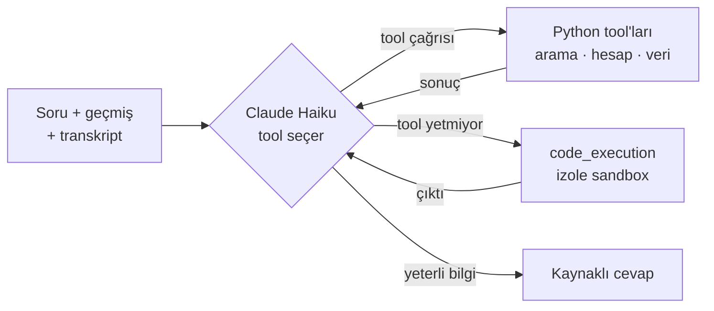

# agentic-rag

**Mühendislik fakültesi öğrencileri ve danışman hocalar için tool çağıran bir LLM agent: mevzuatı arar, transkripti
okur, mezuniyet ve not hesaplarını kodla yapar, her bilginin kaynağını gösterir.**

**Öne çıkanlar**
- 15 tool + code execution ile elle yazılmış agent döngüsü (framework yok): mevzuat araması, madde gezinme, transkript analizi, not ve
  ders simülasyonu, mezuniyet şartları, ders programı ve şube planı, duyurular, akademik personel.
- Hiçbir tool'un çözemediği hesaplar için **code execution**: model Python yazar, kod Anthropic'in izole sandbox'ında
  çalışır. Sık tekrar eden çözümler kalıcı tool'a dönüştürüldü (kod çalıştırılan soru 9 → 1).
- Retrieval hattı kardeş proje [mevzuat-rag](https://github.com/ariftahab/mevzuat-rag)'den: bge-m3 + BM25 (RRF) ve
  cross-encoder reranker; madde düzeyinde atıf.
- 21 kayıtlı deney; her biri tek değişiklik, hipotez koşmadan önce yazılır, sonuçlar eşleştirilmiş testlerle sınanır.
- Ayarlamada kullanılmayan validation setinde **110 sorudan 107'si anlamca doğru**; prompt injection testleri 10/10.

*In English:* agentic-rag is a tool-calling LLM agent for academic advising in a Turkish engineering faculty. Instead of a
single retrieve-then-generate step, Claude Haiku decides which of 15 tools to call (regulation search, article
navigation, transcript analysis, GPA and course simulations, graduation requirements, course schedules, announcements,
staff lookup); all calculations run in deterministic Python, and when no tool fits, the model writes and runs code in
Anthropic's sandboxed code-execution environment. The agent loop is hand-written rather than framework-based (see
[ADR 0001](docs/adr/0001-hand-written-agent-loop.md)). Every change is a logged single-variable experiment; on a held-out
validation set of 110 questions the agent answers 107 correctly and passes all 10 prompt-injection tests.

---

## Ne yapar?

Öğrenci ya da danışman hoca şöyle sorular sorar:

- "Staj başvurusunu ne zamana kadar yapmam gerekiyor?" → mevzuattan, madde atıfıyla
- "Mezun olmak için neyim eksik?" → yüklenen transkript, öğretim planı ve yönetmelik kurallarıyla hesap
- "Bu dönem bu üç dersten 70 alırsam ortalamam kaça çıkar?" → not simülasyonu
- "B şubesinden alırsam neyle çakışır, Cuma boş kalabilir mi?" → ders programı ve şube planı
- "Bilgisayar Donanımı ana bilim dalı başkanı kim?" → akademik personel verisi

Klasik RAG'de her soru aynı yoldan geçer: ara, ilk 5 chunk'ı modele ver, cevap üret. Bu soruların çoğu öyle çözülmez:
bir kısmı hesap ister, bir kısmı iki kaynağı (öğrencinin transkripti + yönetmelik maddesi) birleştirmeyi ister. Agent
hangi bilgiye ihtiyaç olduğuna kendisi karar verir.

## Nasıl çalışır?



1. **Döngü.** Model her turda ya tool çağırır ya da cevabı yazar; tool sonuçları mesaj olarak geri verilir. Tur sayısı
   sınırlıdır (sonsuz tool isteğine karşı).
2. **Karar modelde, hesap kodda.** AKTS toplama, ders eşleme, ortalama ve şube çakışması deterministik Python'da
   (`tools/`) yapılır; model yalnız tool'u seçer ve sonucu cümleye döker. Sayılar tool çıktısından olduğu gibi aktarılır.
3. **Kişisel veri modele gitmez.** Transkript bir tool argümanı değildir; oturumda durur, `analyze_transcript` onu kendisi
   okur ve modele yalnız değerlendirme raporu gider. API stateless: geçmiş ve transkript istemcide kalır.
4. **Code execution.** Tool'ların kapsamadığı bir hesapta model Python yazar; kod Anthropic'in sunucu tarafı sandbox'ında
   çalışır (her soru yeni container, internet yok, yalnız o istekte yüklenen dosyalar görünür). Bu makinede kod çalışmaz.
5. **Atıf.** Mevzuat sonuçları belge düzeyi ve tarihleriyle döner; aynı konuda iki belge çelişirse geçerli hüküm seçilir.
   Cevaptaki her atıf arayüzde ilgili maddeyi açar.

### Neden framework yok?

LangGraph gibi bir framework yerine döngü Anthropic SDK ile elle yazıldı. Tek agent, tek model ve stateless bir API
var; framework'ün getirdiği sunucu tarafı durum, kesintiye uğrayıp devam eden akış ve çoklu agent bilinçli olarak
kullanılmıyor. Sunucu tarafı code execution, sandbox'a dosya yükleme ve prompt caching doğrudan SDK ile yazıldı; her
tur ve tool çağrısı kendi kodumuzda loglanıyor. Gerekçe, alternatifler ve kararın ne zaman yeniden açılacağı:
[ADR 0001](docs/adr/0001-hand-written-agent-loop.md).

## Deneyler

Her değişiklik `experiments/configs/EXP-XXX.json` olarak kaydedilir: bir üst deneyden tek fark, koşmadan önce yazılmış
hipotez ve birincil metrik. Sonuç dosyası commit hash'ini saklar; günlük `experiments/experiment_log.md`'de.

| Set | Ne için | Boyut |
|---|---|---|
| Dev | Prompt ve tool denemeleri | 53 soru |
| Validation | Yalnız ölçüm; üzerinde ayar yapılmaz | 110 soru, 8 kategori (koşul/istisna, birleştirme, çapraz atıf, takvim, çekimser kalma, prompt injection vb.) |

Cevaplar anahtar kelimeyle değil anlamca değerlendirilir; ayrıca beklenen tool'un çağrılıp çağrılmadığına bakılır.

**Neyin işe yaradığı (ve yaramadığı):**

| Değişiklik | Etkisi |
|---|---|
| Daha küçük model (gemini-3.5-flash-lite → 3.1-flash-lite) | Cevap doğruluğu 0,88 → 0,68 (p = 0,003), latency ~4 kat: model seçimi kritik |
| İki modelli yapı (Gemini + kod için Haiku) → tek model (Haiku) | Gereksiz devirler kalktı, hesap soruları düzeldi |
| Prompt caching | Değerlendirme koşusu başına maliyet $0,27 → $0,12 |
| Duyuru ve personel tool'ları | Cevap doğruluğu 0,83 → 0,96 (p < 0,05): doğru tool, prompt yamasından etkili |
| Sık yazılan kodu kalıcı tool yapmak | Kod çalıştırılan soru 9 → 1, cevaplar aynı |
| Cevabı denetleyen ikinci model (en fazla 3 tur) | **İşe yaramadı:** 43 → 41 doğru, süre 3 kat. Denetleyici agent'ın bağlamını görmediği için doğru cevaplara yanlış alarm verdi |
| Madde gezinme tool'ları + belge düzeyi ve çelişki kuralı | Dev'de 43 → 46; validation'da 101 → **107/110** |

## Bilinen zayıflıklar

- Birden fazla kaynağı birleştirmeyi gerektiren sorular en zayıf tür: kural tarafı bazen hiç aranmıyor.
- Model zaman zaman gereksiz tool çağırıyor; bu hata sayılmıyor ama latency'yi artırıyor (soru başına ~10-15 sn).
- Belge kümesi 24 belgeyle sınırlı (lisans ve lisansüstü yönetmelikler, staj, çift anadal, yandal, intibak vb.) ve tek
  bölümün öğretim planı ve ders programı var.

## Kurulum

```bash
python -m venv venv
venv\Scripts\activate          # Windows
pip install -r requirements.txt
```

GPU için torch'u önce CUDA build'iyle kurun (`requirements.txt`'teki nota bakın). Proje köküne `.env`:

```
ANTHROPIC_API_KEY=...          # agent (Claude Haiku) ve code execution
GOOGLE_API_KEY=...             # klasik RAG yolu (/ask) ve eski agent sürümleri
ADMIN_USER=...                 # isteğe bağlı: /admin değerlendirme paneli
ADMIN_PASSWORD=...
```

İlk çalıştırmada embedding ve reranker modelleri (~6,5 GB) indirilir.

## Kullanım

```bash
python -m uvicorn app.main:app --port 8000   # web arayüzü + API
python chat.py                               # terminal sohbeti
```

| Adres | İçerik |
|---|---|
| http://localhost:8000/ | Sohbet; transkript yüklenebilir, tool çağrıları ve kaynaklar görünür |
| http://localhost:8000/belgeler | Belgeler ve chunk'ları; atıflardan buraya gelinir |
| http://localhost:8000/araclar | Agent'ın tool'ları |
| http://localhost:8000/admin | Cevapları etiketleme ve deney sonuçları |
| http://localhost:8000/docs | API dokümantasyonu (Swagger) |

Deneyler:

```bash
python -m experiments.run EXP-021 --llm   # bir deneyi koş (cevap doğruluğu dahil; API kotası harcar)
python -m experiments.report              # deney günlüğünü yeniden üret
pytest                                    # testler (345); mutasyon testi: cosmic-ray.toml
```

## Proje yapısı

```
agent.py            agent döngüsü, tool tanımları, system prompt sürümleri
tools/              deterministik tool'lar: transcript, graduation, gpa, schedule, articles, announcements, codeact
rag.py, ingest.py   retrieval hattı (hybrid + reranker) ve indeksleme
app/                FastAPI (api.py, service.py) ve vanilla JS arayüz (static/)
experiments/        koşucu, değerlendirme metrikleri, rapor, deney config'leri ve sonuçları
eval/               dev ve validation soru setleri, örnek transkriptler
data/               mevzuat PDF'leri, öğretim planı, ders programı, personel verisi
tests/              pytest
```

## Kullanılan teknolojiler

Python 3.11 · Claude Haiku (Anthropic SDK: tool use, code execution, prompt caching) · LangChain · sentence-transformers
(bge-m3, bge-reranker-v2-m3) · FAISS · BM25 · FastAPI · pytest · cosmic-ray

## Geliştiren

Arif Taha Bülbül · [LinkedIn](https://www.linkedin.com/in/arif-taha-b%C3%BClb%C3%BCl-824a451b4/) ·
[GitHub](https://github.com/ariftahab)

## Lisans

Kod [MIT](LICENSE) lisansıyla dağıtılır. `data/` klasöründeki PDF'ler ve kampüs verileri Bolu Abant İzzet Baysal
Üniversitesine aittir ve lisansın kapsamında değildir.
